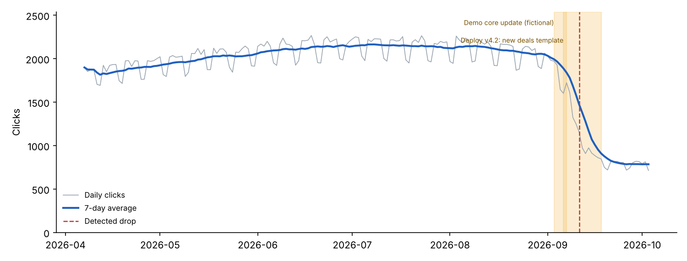

# TrailPeak Outdoors: Organic Traffic Drop Diagnosis
**Period analyzed:** Aug 9 – Sep 5, 2026 vs Sep 6 – Oct 3, 2026 · **Prepared by:** [Agency] · **Date:** Oct 4, 2026

> **Demo.** This site, its data and the "core update" are fictional. They were generated to show what the finished deliverable looks like.

## 1. Executive summary
- Organic clicks fell **53%** (57,274 → 26,758 over 28 days). The fall was sudden and began around **September 9–11**. The same weeks last year were nearly flat (−6%), so this is **not seasonal**, and nothing has recovered yet.
- There are **three separate causes**, each confined to one part of the site:
  1. **Reviews section lost rankings** in the September core update. This is **≈48% of the loss**.
  2. **Guides now get fewer clicks** at the same rankings, because Google shows AI answers. This is **≈31% of the loss**.
  3. **Deals section dropped out of Google** after the Sep 6 deploy. This is **≈20% of the loss**.
- **About 69% of the loss is fixable** (deals, reviews). The guides loss is mostly a market change, and we will adapt to it rather than chase it.
- **First priority:** fix the deals pages today. It's low effort, and pages usually return within days to a few weeks.
- Brand searches are stable (−4%), so demand for TrailPeak itself is healthy.

## 2. What happened

Traffic was steady through the summer, then fell by more than half within about 10 days in early September. Two events overlap this window: a Google core update (Sep 3–18) and our own deploy of a new deals template (Sep 6).

## 3. Why it happened
| # | Cause | Confidence | Share of loss | Evidence |
|---|---|---|---|---|
| 1 | Deals pages dropped out of Google's index | High | ~20% | /deals/ impressions −90% while position stayed at 4.3. The pages still rank when shown but are almost never shown. This started right after the Sep 6 deploy |
| 2 | Reviews pages lost rankings in the core update | High | ~48% | /reviews/ average position 3.7 → 7.7. The drop date matches the update rollout. 48% of lost clicks come from ranking losses, almost all in /reviews/ |
| 3 | AI answers taking clicks on guide topics | Medium–High | ~31% | /guides/ position unchanged (3.5 → 3.7) but clicks −45%. Informational queries lost 42% CTR, vs 8% for other queries |

**Deals.** The new template most likely ships with a `noindex` tag or a canonical pointing elsewhere. *How to confirm:* inspect any deals URL in Search Console and view the page source.

**Reviews.** Competitors' review pages now outrank ours on "best [product]" searches. *How to confirm:* compare the current top 3 results for our 10 biggest losing queries: their depth, testing evidence, freshness and authorship.

**Guides.** "How to choose…" searches now show an AI-generated summary above the results. People get a quick answer and click less. *How to confirm:* search our top 10 guide queries and record which ones show an AI Overview.

## 4. What we can't fully recover
Some guide traffic won't come back, because the answer now appears directly in Google. Our rankings are intact, so we'll focus on getting **cited** in those AI answers and on turning guides into stepping stones to reviews and deals, where purchase intent is higher.

## 5. Action plan
| Priority | Action | Fixes | Impact | Effort | When |
|---|---|---|---|---|---|
| 1 | Remove noindex or wrong canonical from the deals template, resubmit the sitemap, request indexing for the top deals URLs | Deals | High | Low | This week |
| 2 | Add a pre-deploy SEO check (noindex, canonicals, robots.txt) | Prevents repeats | Med | Low | This week |
| 3 | Audit the top 10 review pages against the winners: real testing evidence, photos, author expertise, update dates, comparison tables | Reviews | High | Med | Weeks 2–6 |
| 4 | Answer-first summaries and original data (test results, sizing charts) in guides; title/meta refresh; internal links from guides to reviews | Guides | Med | Med | Weeks 3–8 |
| 5 | Confirm Security & Manual Actions shows no issues | Rule-out | High | Low | Today |

## 6. How we'll measure recovery
- **Deals:** indexed pages and impressions back near baseline. Typically days to a few weeks after the fix.
- **Reviews:** average position for the top 20 "best" queries, tracked weekly. Movement often shows at or after the next core update.
- **Guides:** CTR at a stable position, AI-answer citations, and assisted conversions.
- **Overall:** non-brand clicks and organic revenue, checked weekly for 4 weeks, then monthly.

## 7. Appendix
See `report.md` (full tables: sections, brand vs non-brand, top losing queries and pages, devices, countries), plus `losers_queries.csv`, `losers_pages.csv` and `sections.csv`.
