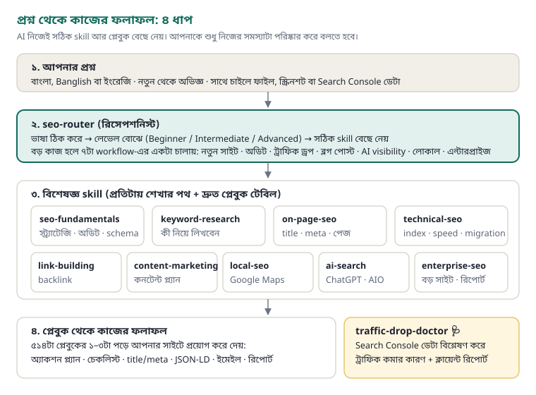

# SEO Skills Pack: How the System Works (for experienced users)



## Architecture
| Layer | What it is | Where |
|---|---|---|
| 1. Request | Any language (Bangla, Banglish, English), any level, optionally with files or Search Console exports | The user |
| 2. Router | `seo-router` detects language and level, routes to the right skill, and runs 7 multi-skill workflows | `skills/seo-router/SKILL.md` |
| 3. Specialist skills | 10 topic skills, each with a Beginner/Intermediate/Advanced learning path and a Quick playbooks table | `skills/<name>/SKILL.md` |
| 4. Playbooks + tool | 514 vendor-neutral playbooks (TL;DR → framework → checklist → data → mistakes → principles) and the Traffic Drop Doctor analyzer | `skills/<name>/articles/`, `traffic-drop-doctor/scripts/` |

Progressive disclosure keeps context small. The agent reads one router file and one skill file, then only the 1–3 playbooks it needs.

## Workflows (ask for them by name)
| Workflow | Use when | Skills chained |
|---|---|---|
| A. New or small site plan | Starting out | (local check) → technical → keyword → content → on-page → links → expectations |
| B. Full audit | Client onboarding, annual review | technical → on-page → content → links → AI visibility |
| C. Traffic drop | Clicks or rankings fell | traffic-drop-doctor (or fundamentals → technical → content → AI search) |
| D. Blog post | Keyword → publish | keyword → content → on-page → AI search → links |
| E. AI visibility | ChatGPT, AI Overviews | ai-search audit → content/on-page → link-building → tracking |
| F. Local business | Physical location or service area | local → on-page → links → content |
| G. Enterprise | Large sites, stakeholders | enterprise (forecast, reporting, OKRs) + technical at scale |

Example prompt: "Run workflow B for example.com and return an issue list with impact, effort, owner and fix."

## Traffic Drop Doctor
```
python 3-coding-agents/skills/traffic-drop-doctor/scripts/analyze_gsc.py \
  --export compare.zip --dates Dates.csv --brand "brand,brand name" \
  --events 3-coding-agents/skills/traffic-drop-doctor/references/google-updates.csv --out report
```
Try it on the bundled demo first (run from the pack root):
```
python 3-coding-agents/skills/traffic-drop-doctor/scripts/analyze_gsc.py \
  --export 3-coding-agents/skills/traffic-drop-doctor/examples/demo-export.zip \
  --dates 3-coding-agents/skills/traffic-drop-doctor/examples/Dates.csv \
  --events 3-coding-agents/skills/traffic-drop-doctor/examples/events.csv --brand trailpeak --out demo-report
```
It splits the click change into an impressions effect and a CTR effect, then labels every losing query and page (ranking, CTR, demand, disappeared). It also:
- finds section collapses and migrations (pairing old and new URLs by slug)
- detects the AI Overview pattern of CTR loss at a stable position
- splits brand from non-brand
- separates seasonality using year-over-year data
- matches the drop date to events
- warns when data is stale or an export is truncated

It needs only the Python standard library; matplotlib is optional and adds a chart.

## Advanced playbooks
- keyword-clustering-at-scale
- large-site-migration-playbook (including a 4-week compressed plan)
- manual-ai-visibility-audit
- seo-forecasting-model (ROI and payback)
- multi-location-operations
- title-audit-at-scale
- schema-markup (ready JSON-LD)

## Extending the library
1. Add `articles/<slug>.md` with the same sections.
2. Link it from that skill's Quick playbooks table and from `ARTICLES.md`.
3. Run `python tools/validate_skills.py 3-coding-agents/skills --strict`.
4. Repackage with any zip tool. Each skill folder zipped on its own is a `.skill` file.

## Limits
- Statistics come from third-party studies up to 2026; verify critical numbers.
- Nothing here guarantees rankings.
- White-hat only.
